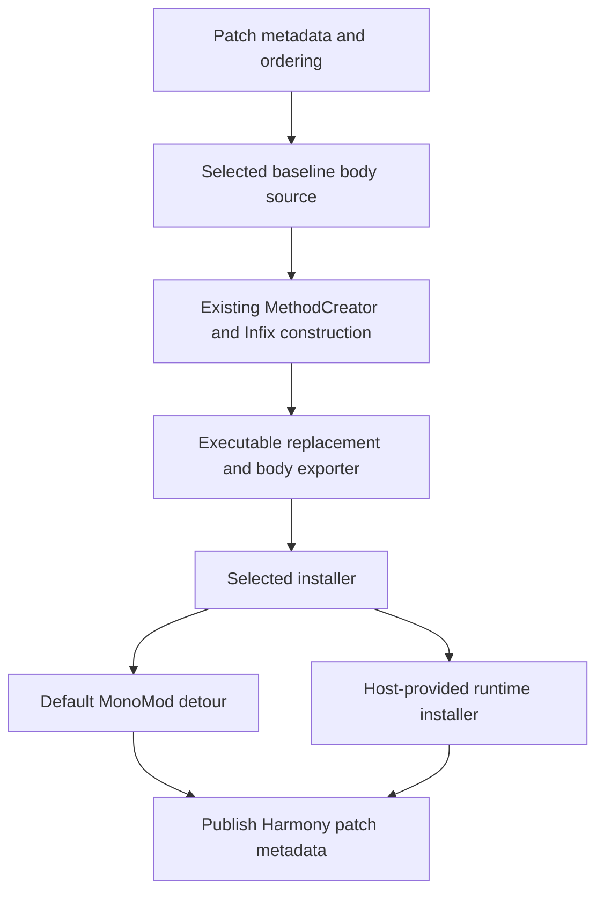

# Optional method-body patching

Status: implemented on `v3`, updated after the 2026-11-06 generics, lifecycle and export fixes.
The verification document separates earlier runtime deliveries from current source and test results.
The Harmony Mod adapter lives outside the tracked library in `artifacts/runtime-patching-20261102/mod-worktree`.
Adapter sections below describe earlier recorded integration tests. They do not establish current publication or runtime acceptance of the review fixes.
Two stock test hosts cover the contract without a runtime fork, see [Hosts](#hosts). The user documentation is `Documentation/articles/hosting.md`.
Current acceptance and remaining limits are recorded in [the verification document](METHOD-BODY-PATCHING-VERIFICATION.md).
Review findings, their alternatives and the maintainer decisions are recorded in [the decision record](METHOD-BODY-PATCHING-DECISIONS.md).
Superseded versions of these drafts, including both review handoffs, are archived under `artifacts/drafts-archive-20261106/`.

## Purpose and limits
Let a host choose how Harmony reads a target's baseline body and installs its replacement.
Keep Harmony independent of game types, runtime forks, startup phases and runtime-specific dependencies.
Harmony Mod supplies the adapter between Harmony and the host runtime.

The contract addresses one class of runtime: a runtime that replaces a method's IL body through tokens of the method's own module, with Harmony as one rewriter among others.
Three runtimes belong to that class: Waylith's `MethodBodyUpdater` in RimWorld 1.7, the CoreCLR profiler ReJIT API, and .NET hot reload through `MetadataUpdater.ApplyUpdate`.
All three take a complete CLI body with imported tokens, and all three compile a generic method from one body per definition, so definition-wide installation is natural for them.
Mono and Unity are outside the class and keep the detour. Weaving assemblies on disk is outside it too, because Harmony constructs from loaded `MethodBase` objects.
The test suite carries two hosts of that class that need no runtime fork. See [Hosts](#hosts).

The existing patch constructor, validation, sorting, Infix implementation and executable method writer remain shared.
Ordinary runtimes retain their current MonoMod installation path.
The adapter is an alternative installation mechanism, not an alternative implementation of patch semantics.

The host installs the complete transformed body into the original method using Harmony's construction and byte encoder.
A closed instantiation with transpiler or Infix patches calls a helper, adding one stack frame.
Refused static callback calls can also use forwarding stand-ins.
Startup cost, steady-state call cost and metadata lifetime are measured separately, see the verification document.

## Principles
- Preserve accepted patch bindings, ordering, owner-specific unpatching, reverse-patch semantics and returned replacement identity.
- Keep the default mechanism and its supported runtime coverage.
- Select one coherent source/installer pair before constructing a replacement. Keep that selection stable for the target.
- Read one fresh body snapshot per construction. Use the same snapshot for its locals and instructions.
- Preserve exact target identity, including constructed generic arguments and load contexts.
- Reject only established illegal bindings or IL. This work adds no broader IL validation.
- Fall back only when the provider declines before mutation. Never hide an installation failure with another mechanism.
- Keep runtime policy in the host adapter. Do not add a capability registry, backend hierarchy or parallel patch constructor.
- Measure invocation cost, installation cost, allocation and lifetime separately.

## Responsibilities


Harmony owns patch semantics and metadata publication.
The host owns runtime discovery, eligibility, body ownership, installation completion, failure recovery and callback lifetimes.
The runtime owns safe code-version transitions, active frames, generic compilation and inliner invalidation.

## General API
`MethodBodyPatching` registers up to three BCL delegates, one per call:

```csharp
MethodBodyPatching.SetEligibility(CanUseRuntimeInstallation);
MethodBodyPatching.SetBodySource(ReadLatestBaseline);
MethodBodyPatching.SetInstaller(InstallReplacement);
```

Each part accepts one delegate. Null keeps Harmony's default for that part: no owned methods, reflection, or the ordinary detour.
Without an installer, generic targets keep the Harmony 2 detour behavior. A future capability is a new call, never an overload.

| Operation | Contract |
| --- | --- |
| `accepts(MethodBase)` | Decide eligibility without mutation. False keeps the default path. An exception fails the attempt without pinning a decision. |
| `readBody(MethodBase)` | Return an owned baseline snapshot as `System.Reflection.MethodBody`. Its tokens resolve in the target module and generic context. Exclude the provider's own installed forwarding/replacement body. |
| `install(MethodBase, MethodInfo, Func<Func<object, int>, byte[]>)` | Install the replacement or export its complete CLI body through a host token importer. The replacement is null for a definition-wide target, which has no callable copy. Report failure before Harmony publishes patch metadata. |

Two queries join the three registrations. `Instantiations(definition)` lists the closed instantiations pinned to a definition's installer, including one whose installation is in progress. `Rebuild(method)` rebuilds a patched target, or a reverse-patch stand-in, from Harmony's current state through its pinned installer. The baseline-body helper remains internal.
Harmony's own reflection reader and detour are delegates of the same two shapes, kept per Harmony copy outside the shared record. Every body read and every installation goes through the same two calls, with the registered part for host-owned targets and Harmony's own part otherwise.
Existing public instruction readers use that helper, so patch authors keep their current API.
The public contract uses standard BCL delegates rather than new provider interfaces or body-container types.

The exporter accepts runtime `Type`, `MethodBase`, `FieldInfo`, string and standalone-signature byte arrays.
A `KeyValuePair<Type, bool>` with true requests a generic definition instantiated over its own type parameters.
A `KeyValuePair<MemberInfo, bool>` with true requests a self-instantiated member, including a generic method instantiated over its own parameters.
For a generic declaring definition, emit a MemberRef with a self-instantiated TypeSpec parent and the member definition's signature.
A generic method also requires a MethodSpec. Definition methods use their own parameters. Already constructed methods keep their arguments.
Its importer returns tokens valid in the original module. The shared encoder writes instructions, signatures, locals, headers and exception sections.
The exporter permits one synchronous call during installation. It must not escape that call or run on another thread.
The importer returns zero for a value it cannot import.
For a refused call to a static method without open generic parameters, Harmony offers a stand-in with an exact delegate signature.
The collectible stand-in remains retained while its callback is live. If the host refuses it, Harmony offers a permanent stand-in.
Generated closed helpers reuse permanent entries by original, helper site and signature. Successful installation publishes delegate changes.
Failed installation preserves the previous delegate. Older bodies calling that entry also see the latest successful delegate.
Ordinary reflection callbacks use module, metadata token, declaring type and method arguments as identity. Distinct dynamic callbacks add separate permanent entries.
Generated open generic helpers instead escalate to permanent images. These can accumulate per generated helper across rebuilds.
A permanent helper cannot reference collectible dependencies. Generic helper generation requires collectible `AssemblyLoadContext` support.
A refused identity-bearing method operand, including `ldtoken`, `ldftn` and `ldvirtftn`, cannot use a forwarding stand-in.
Other unsupported refusals fail export. The host must complete export before mutating the installed body.
Hosts must resolve `HarmonyDynamicMethod_*`, `HarmonyGenerated_*`, callback assemblies and other dependencies with their exact loaded identities.
Body export is unavailable in Harmony's net35 and netstandard2.0 builds, regardless of the runtime loading them.
An installer can use a non-null callable replacement without invoking the writer.

Register once during host initialization, with no patch operations active.
Registration is configuration, not a mechanism for moving live targets between installers.
Targets already pinned to the detour, or represented in pre-existing patch metadata, keep the default path.
Once any target is pinned as host-owned, non-null registration of another part throws `InvalidOperationException`.
Null remains a no-op. Register all non-null parts before any host-owned pin exists.
A nongeneric reverse-patch stand-in the host owns installs through the host. Other stand-ins keep the detour.
Host-owned generic reverse stand-ins are rejected before pinning, including closed instantiations.
Harmony keeps an active reverse recipe for `Rebuild`, including default-detour stand-ins.
Successful ordinary installation supersedes that recipe. Failure preserves it. Another participating copy's newer reverse recipe supersedes local ownership.
The former copy refuses to rebuild that foreign recipe. The reverse source still reads its selected baseline.

The protocol uses shared BCL delegates and records. It exposes no MonoMod or Cecil types.
Separately loaded participating Harmony copies can read the same selected source and installer.
Both installers pin their choice in one shared per-target record. The default detour pins at installation, so reverse-patch stand-ins are covered.
Constructed generic arguments remain part of the Harmony target identity.
Inherited reflection views normalize to their declared method without erasing those arguments.

Older Harmony copies do not implement the protocol. They can read already-transformed IL as their baseline and duplicate patches.
Native hooks and profilers that independently replace or clone a target also need an ownership agreement.
The extension does not make arbitrary independent patch engines cooperate automatically.

The unpublished protocol uses the `Harmony.MethodBodyPatching.v1` AppDomain key.
A new root has three slots: registered parts, a boolean installation choice per target, and an unused empty `List<Func<MethodBase, bool>>`.
The third slot satisfies the delivered 20261104 validator. Existing two-slot records remain accepted and unchanged.
Separate shared BCL records track active reverse recipes and installation guards. They do not resize the root.
This establishes record-prefix compatibility, not complete lifecycle cooperation with older implementations.
Accepted targets do not allocate another delegate array or copy the provider's delegates.
Its records contain only BCL values. Future implementations must honor live v1 pins or explicitly refuse incompatible coexistence.
A new protocol key must never silently create an independent owner for the same target.
The public API and protocol remain design decisions until this change is approved for release.

## Host requirements
The two test hosts and the Waylith adapter agree on what a host must bring. The contract text above is the specification. This list is the checklist.

1. Eligibility declines what the host cannot install, before Harmony reads anything: methods without IL, partially open generic methods, and whatever the runtime refuses.
2. The baseline excludes the host's own installed body. Reflection is enough only while the runtime keeps reflection on the baseline, as the module host does.
   A runtime that updates the method itself returns the installed body through reflection. Waylith reads the pipeline's default body, the hot reload host reads the image on disk.
   Either way the host subclasses `MethodBody`, `LocalVariableInfo` and `ExceptionHandlingClause`, in about ninety lines.
3. The importer maps the seven value kinds in the hosting article to tokens of one module. Signature blobs carry tokens of that same module, so a dynamic scope cannot host an exported body: `DynamicILInfo` resolves tokens inside a signature against its owner module, not against its scope.
4. The importer returns zero for a DynamicMethod when its module binds methods by metadata. Harmony's first stand-in is collectible. The runtime refuses a reference from a non-collectible module to a collectible assembly, so such a host checks `Assembly.IsCollectible` and refuses that stand-in too. The permanent stand-in then binds through the host's name resolution, for example a `Resolving` handler on the default load context.
5. Installation runs synchronously under Harmony's patch lock. Byte export permits one writer call on that thread.
   Validation at installation is optional. A runtime that compiles later can report invalid IL at the first call.
6. Registration happens once before any host-owned pin exists. Detour-held targets keep their installer.
7. After changing a baseline, the host calls `Rebuild` outside installation.
8. The runtime must allow calls to private callbacks and Harmony's internal generic guard helpers.
   Hot reload and ReJIT still enforce access checks unless the target module ignores them.
   Harmony's friend-assembly hot reload fixture does not establish access from an arbitrary module.

## Construction, publication and failure
The provider is selected before body reading or patch construction.
The selection is pinned for that target. Rebuilds and unpatches reuse the selected installer.
If the first attempt fails before installation, for example in a transpiler, Harmony releases provisional target and family pins.
Once a registered installer starts, failure retains those pins even when no patch metadata was published.
Default-detour failures release provisional pins. A retained pin cannot move to another installer through later eligibility changes.
Without a provider, body reads use reflection and installation uses the existing MonoMod detour.
The coordination record is created once per AppDomain. Each default detour pins its declared target in that record after installation.
Default detour keys normalize reflected aliases to their declared method while preserving generic arguments.
That bookkeeping is not a demonstrated fix to default patch behavior. Pinning an open generic definition scans the pinned targets once.
A no-provider alias test passes on both the release commit and the modified library.
The shared encoder also has one initially empty proxy cache per Harmony copy on modern targets.
These are installation or initialization costs. They add no dispatch to ordinary patched method calls.
Ordinary, reflective wrapper and reverse-patch construction, installation and publication use the same shared patch lock across participating copies.
Eligibility runs under that lock. Baseline reads during construction also run under it.
Standalone instruction and body readers can invoke the baseline reader outside the lock, concurrently with installation.
The reader must support those concurrent calls. A callback holding the lock must not wait for another Harmony thread.
The installer must not call patch, unpatch, reverse-patch or rebuild operations. A shared guard rejects same-target and same-family re-entry.
`Instantiations` remains available during installation. Independent runtime writers still require host coordination.

Each `MethodCreator` obtains one fresh baseline snapshot.
Locals and copied instructions use that snapshot, including reverse-patch source construction.
Existing public instruction readers and generated-method discovery also read selected baselines through the internal helper.
Unpinned callback methods keep their existing reflection behavior.
Pinned callbacks read their baseline when Harmony copies them for Infix inlining.

Installation precedes metadata publication, as it does today.
If installation throws, Harmony publishes neither the candidate patch metadata nor its prepared persistent state.
The provider must preserve the previous installation when it can establish that guarantee.
If native application leaves an unknown state, the provider must quarantine that target and refuse further writes.
Harmony does not infer transactionality from a void runtime API or perform blind recovery writes.
Rollback attempts disposal for every completed persistent-state preparation even if one attempt fails.
If rollback fails, Harmony throws `Failed to roll back persistent-state hooks.` with the first rollback exception.

Unpatching rebuilds a replacement with the remaining owners, including zero owners.
It does not call a runtime-wide `Revert` operation that could remove another tool's changes.
`Patch()` still returns the generated executable replacement for ordinary targets, and original/replacement lookup keeps its existing behavior.
A definition-wide target has no callable copy. `Patch()` returns the requested definition or instantiation for a method.
A constructor installed through a generic family returns null, whether open or closed.
`Rebuild(definition)` uses member records if the definition has none. A retained pin without rebuild information produces an explicit error.

## Harmony Mod adapter
The adapter lives in the ignored worktree `artifacts/runtime-patching-20261102/mod-worktree`: `Source/RuntimeILPatching.cs`, `Source/RuntimeILBody.cs` and `Source/RuntimeILRegistration.cs`.
The wrapper uses ordinary framework references. Only `HarmonyMod.RuntimeIL.dll` references the runtime's core library, and a module initializer loads it after finding `WaylithClr.MethodBodyTransformer`.
The launch argument `-harmony-detours` or `HARMONY_DETOURS=1` skips registration, so every patch uses the detour. The status line in the game log names the active mechanism.

The adapter registers a `MethodBodyTransformer` at priority 0. Harmony constructs outside runtime callbacks, and the stage replays immutable, module-scoped body bytes.
The baseline is the pipeline's default body from `TryGetDefaultMethodBody`, wrapped in the three BCL body classes by `RuntimeILBody`.
Tokens come from `MethodBodyUpdater.GetTokenFor` and `GetTokenForInstantiation`. The runtime memoizes them and retains the dependencies of active bodies, so the adapter keeps no duplicate cache and no permanent roots.
The installer rebuilds the stage, compiles the installed target and every patched instantiation with `PrepareMethodBody`, and on build 5000 asks the runtime to compile every instantiation it has seen with `PrepareGenericVariants`.
Optional witnesses for a definition default to object and int closings that respect class and struct constraints. A compilation failure restores the previous generation. A failed restoration quarantines the target.

If the pipeline reports a changed default body, the stage detaches and reports outside the callback. `Injection.HarmonyRegenerate` calls the adapter's rebase first, which captures the new baseline and calls `MethodBodyPatching.Rebuild`.
Build 5000 runs field injection as a stage at priority -1000 and Prepatcher free patches at -2000. Both run below Harmony's stage and are part of Harmony's baseline.
Direct body writes that bypass the pipeline are superseded by the next rebuild. The runtime author confirmed that ownership contract.

## Generics
Status: definition-wide construction and runtime installation are implemented locally, 2026-11-02. Guarded instantiation families followed on 2026-11-05, closed bodies for instantiation transpilers and Infix the same day.
The provider accepts fully open method/type definitions. For example, patch `typeof(Box<>).GetMethod("Read")` to select every instantiation of that definition.
With a registered installer, a closed instantiation such as `Box<string>.Read` installs through its accepted definition.
Harmony asks about that definition, not the closed instantiation. Without an installer, eligibility can receive the closed instantiation directly.
The definition's body then carries the union of its own patches and the patches of every instantiation installed through it. Harmony calls this group a family.
A prefix, postfix or finalizer registered on an instantiation runs under a type guard: one `GenericFamily.Is<TParameter, TArgument>()` check per type parameter of the definition.
The guard distinguishes instantiations that share code at runtime, such as `Box<string>` and `Box<object>`. The detour path cannot do that.
An instantiation with a transpiler or an Infix patch owns a closed body. The ordinary single-target path builds it against the instantiation's closed IL from the definition's patches and the instantiation's own, in one priority order, and emits it as a callable helper.
The definition's body enters that helper at its start under the same type guard, bridging by-value arguments and the result with `GenericFamily.As`. By-reference arguments pass unchanged.
The instantiation's transpiler sees closed instructions as it does under a detour.
The definition's transpilers also see those closed instructions and must tolerate substituted types and operands.
The definition's prefixes, postfixes, finalizers and Infix patches also apply inside the helper. `__originalMethod` there is the instantiation.
The call adds one stack frame: caller, definition body, helper. Caller-sensitive code can observe that frame.
Removing the last transpiler or Infix patch of an instantiation returns it to the guarded family body on the next rebuild. The helper is a DynamicMethod the installer imports like any other; the host owns its lifetime.
`PatchProcessor.GetCurrentInstructions`, reverse snapshots and closed helpers merge definition and instantiation transpilers through the existing sorter.
Within each category, priority descends and record index ascends, subject to before/after dependencies.
Indices belong to separate records and can interleave. Equal priority/index ties remain unspecified and unstable.
This is not a guaranteed definition-first order.
A definition cannot join instantiations that the default detour already holds. That stays an explicit error. A closed instantiation requested after such a sibling joins the detour, and the definition stays unpinned.
With an installer, partially open targets such as `Box<string>.M<U>` reach eligibility and receive an explicit error if accepted.

Harmony retains its existing constructor, binder, ordering, validator, encoder and assembly writer.
`GenericMethodContext` supplies the original generic context to MonoMod's reflection importer.
The wrapper records exact runtime operands for export because MonoMod cannot resolve an open generic parameter back through reflection.
It does not introduce another IL reader or writer. Ordinary targets retain their previous generation path.
Type parameters stay on the generated holder. Method parameters stay on its method. VAR/MVAR positions are not flattened or remapped.
There is no callable snapshot of a definition-wide replacement. `Patch()` returns the definition. The stock tests generate a snapshot from the constructed body when they need to execute it directly.
Runtime constraints are copied. The synthetic class holder removes source variance annotations, which are invalid on a class.

Generic ordinary Prefix/Postfix/Finalizer callbacks receive the target's declaring-type parameters, followed by its method parameters.
The callback must declare exactly that number of generic parameters.
Register the callback definition rather than a directly constructed generic method or a method on a constructed generic patch class.
Shared patch metadata stores module/token identity and would lose those fixed arguments on rebuild.
The family path rejects that registration on both definitions and closed instantiations before installation.
Use an existing factory when a fixed instantiation is intentional.
Factory outputs retain their concrete method/type arguments because the factory runs again on rebuild.
Harmony binds the callback with `MakeGenericMethod`, which also checks its constraints against the target parameters.
Transpilers remain patch-time functions and can inspect the supplied open MethodBase.
Infix callbacks retain their existing nongeneric contract. Generated Infix helpers can carry the outer definition's generic context.

A callback can select a narrower case explicitly:

```csharp
static void Postfix<T>(ref int __result)
{
    if (typeof(T) == typeof(string)) __result += 100;
}
```

Callbacks registered on an instantiation keep their closed signatures, for example `Postfix(Box<string> __instance, string value, ref string __result)`.
Harmony bridges each by-value binding between the definition's open type and the callback's closed type with `GenericFamily.As<TOpen, TClosed>()`, which the JIT folds in specialized code.
A generic callback definition registered on an instantiation binds to that instantiation's type arguments.
`__state` is private to a patch class and registration target, including inside closed helpers.
Definition-wide bindings require an assignment guaranteed by the open source and its constraints. Unchecked reference binding does not bypass that guarantee.
Closed callbacks and passthrough results validate closed types. Pointer and byref-like bridges retain their storage.
Generic family bridges reject function-pointer signatures before installation.
Foreign generic parameters in method, constructor and field operands are rejected. Literal open type tokens remain supported.
The new binding reasons are `The open source type does not guarantee the requested type` and
`The supplied type cannot be assigned to every instantiation of the open destination`.
Both retain the existing diagnostic context for the original, patch, binding, operation, supplied type and requested type.
Fixed callbacks fail with `Register the generic callback definition, or use a factory to preserve a fixed instantiation: ` followed by the callback description.
Foreign parameters fail with `The generic parameter belongs to another definition: ` followed by the parameter.
Function-pointer bridges fail with `Generic family bridges cannot emit function-pointer signatures with the current runtime importer.`
By-reference bindings pass the definition's address unchanged. `__originalMethod` of such a callback is the instantiation.
Patch identity stays exact: `Harmony.GetPatchInfo(Box<string>.Read)` lists only that instantiation's patches, and `Patch()` returns the instantiation.
Every rebuild of a member rebuilds the whole family body from the current patch records. The host receives the definition and no callable copy.
Owner-specific removal rebuilds the definition-wide body through the existing patch metadata.
Constructed views inherit the selected definition's baseline reader and transpilers for IL inspection and reverse snapshots.
The provider receives the requested view so its locals and tokens retain the correct generic context.
Public patch registration and `Harmony.GetPatchInfo` retain exact target identity.
`__originalMethod` uses runtime method handles and, for generic declaring types, a self-instantiated declaring-type token.
The export regressions verify closed identities for methods on generic types, recursive generic methods, and combined type/method parameters.
Generic callback arguments also provide the current instantiation's types.

### Generic token identity
Reflection collapses `Box<T>` over its own parameters to the same Type object as `Box<>`.
A runtime probe caught a silent error: `typeof(Box<T>)` returned the open definition after installation.
The reader now records whether an original `ldtoken` used a TypeSpec when reflection would lose that distinction.
CodeInstruction copying preserves that annotation. New instructions default to literal definition semantics for `ldtoken`.
To replace such an instruction with the literal definition, construct a new CodeInstruction rather than reassigning the identical Type singleton.
Other executable type positions and local signatures use the source generic context.

The exporter distinguishes a typical generic instantiation using `KeyValuePair<Type, bool>(definition, true)`.
The adapter maps that value to `GetTokenForInstantiation`. Literal definitions use the distinct ordinary type-token API.
This is a BCL-only extension to the unpublished token-import contract, not a new public registration method.
Instruction copying across engines requires preservation of this annotation. Older nonparticipating engines remain outside the cooperation guarantee.

### Generic compilation and failure
A definition-wide body has no callable copy, so the adapter validates it by compiling.
It compiles the patched instantiations from `MethodBodyPatching.Instantiations` and the optional witnesses, and on build 5000 asks the runtime to compile every instantiation it has seen.
A definition without any witness installs anyway. An instantiation nobody has seen compiles at its first call, so invalid transpiler IL for it fails there instead of in `Patch()`.
On compilation failure the adapter restores the previous complete body and compiles its validation cases again. Rejection happens during `Patch()`, and the previous instantiations and patch metadata survive.
No universal generic IL verifier or type solver is claimed. These checks do not establish that issue #782 is fixed for every reported runtime or setup.

## Profiler, EnC and field injection
Harmony owns its pipeline input and output. Later transformers may change that output.
Harmony runs at priority 0. The native instrumentation profiler runs at priority 1000.
Actual profiler enable/disable, repatching and owner-specific unpatching pass inside the loaded game.
No observer stage or private runtime registry access was added to police the final pipeline body.

The adapter stores frozen output rather than running Harmony or arbitrary transpilers under the runtime pipeline lock.
If its upstream input changes, the stage detaches and queues a visible host error outside the callback.
Reads preserve the detached fault. They cannot clear it and accidentally turn a failed stage into success.
The host can explicitly rebase a target with `RuntimeILPatching.Rebase` outside callbacks while normal Harmony operations are quiescent.
That rebuild captures new upstream input and uses the existing Harmony patch processor.
Constructed reflection views resolve to the provider-owned original definition for this operation.

EnC and arbitrary earlier transformations are therefore detected, not automatically composed.
Already-returned replacement and reverse-patch snapshots do not update when the original is rebuilt.
Final unpatching retains a regenerated baseline, matching existing Harmony behavior.
A later upstream edit can also detach that retained stage.

Direct `ReplaceMethodBody` calls that bypass a managed pipeline target are superseded by its next rebuild. The runtime author confirmed this ownership contract.
Independent detours and nonparticipating patch engines still require their own coexistence agreement.

Build 5000 runs field injection as a pipeline stage at priority -1000 and Prepatcher free patches at -2000. Both run below Harmony's stage at 0 and are part of Harmony's baseline.
The compatibility probe keeps a staged free patch through patch and unpatch.

## Stack frames
A patched method runs its own body, so frames inside it name the original method. `Harmony.GetMethodFromStackframe` and `GetOriginalMethod` return that method unchanged. The callable copy that `Patch()` returns and the closed body of a transpiled or infixed instantiation are registered as replacements of their method, so a frame inside either resolves to the instantiation, as the frames of a detour replacement did.

## Verification and adoption gates
Local proof uses stock .NET 10/x64 for the generic extension and the actual shipped game apphost for runtime claims.
The runtime tests exit from a startup hook before game initialization and use an isolated data directory.
The separate all-mod acceptance run exercises a loaded save, rendering, ticks, save/reload and actual profiler instrumentation.
See the verification document for the current engine, artifact hashes and the bounded coverage.

The test and probe record is maintained alongside the local artifacts under `artifacts/runtime-patching-20261102`.
Run the generic tests through `scripts/test.sh`.
The mod prototype has its own bounded `Tests/RuntimeIL/run.py` command.

## Existing designs considered
[HarmonyX's custom method patcher](https://github.com/BepInEx/HarmonyX/wiki/Custom-MethodPatcher) demonstrates a per-target source/installer boundary.
Its public MonoMod/Cecil contracts do not fit Harmony's internalized Fat package directly.
[MonoMod's detour factory](https://github.com/MonoMod/MonoMod/blob/reorganize/src/MonoMod.Core/IDetourFactory.cs) remains the default installer.
It does not select Harmony's baseline source and is internalized in the Fat package.
The new boundary addresses those concrete gaps without adopting another patch manager or rebuilding either library.

## Hosts
Two test hosts live in this repository. Earlier Waylith adapter evidence is recorded separately.
The stock metadata hosts compile on net7.0 and later. Hot reload also requires its opt-in environment variable.
Earlier CI results do not imply that opt-in hot reload cases ran.

| Host | Where | Installs by | Baseline | Generics | Proves |
| --- | --- | --- | --- | --- | --- |
| Waylith adapter | Harmony Mod, `RuntimeILPatching` | `MethodBodyUpdater` pipeline stage at priority 0 | pipeline default body | definition-wide, variants compiled by the runtime | earlier private integration tests, see the verification document |
| Module host | `HarmonyTests/Patching/MethodBodyExportHost.cs` | writes a fresh module with `System.Reflection.Metadata`, loads it collectible, detours the original to the new method | reflection | declined | real module tokens in IL, signatures and exception clauses; stand-ins for DynamicMethod callbacks and Infix helpers; refusal before installation |
| Hot reload host | `HarmonyTests/Patching/MethodBodyHotReloadHost.cs` | an EnC delta into the original module through `MetadataUpdater.ApplyUpdate` | the image on disk | definition-wide, warm and cold instantiations | the body lives in the original method with no detour; a definition's body reaches every instantiation; unpatch restores the baseline |

The hot reload host runs only with `DOTNET_MODIFIABLE_ASSEMBLIES=debug` set before the test host starts and a Debug build of `HarmonyTests`. Its fixture ignores itself otherwise:

```bash
DOTNET_MODIFIABLE_ASSEMBLIES=debug HARMONY_DOTNET="$HOME/.dotnet/dotnet" \
DOTNET_ROOT_X64="$PWD/artifacts/runtimes/dotnet10-x64" DOTNET_ROLL_FORWARD=LatestPatch \
  ./scripts/test.sh -c Debug -f net10.0 -p:TargetFrameworks=net10.0 -p:PlatformTarget=x64 \
  -p:GeneratePackageOnBuild=false --artifacts-path "$PWD/artifacts/local-debug" \
  --filter FullyQualifiedName~MethodBodyHotReloadHost
```

Both test hosts share one metadata emitter. A delta differs from a fresh module in four rules, all learned against the runtime: no body may sit at offset zero of the IL delta, the delta's MVID is a fresh copy of the baseline's, heap offsets and row numbers continue from every earlier generation, and the module's own definitions are referenced by their existing tokens.

## History
The design went through a forwarding prototype, a direct-install prototype on 1.7.4995, an API audit that narrowed the public addition to three registrations, two adversarial reviews, the definition-wide generic implementation, guarded instantiation families, closed bodies for instantiation transpilers, the 1.7.4998 pipeline integration and the compatibility review for the 1.7 release.
The decision record keeps each finding with its alternatives and outcome. The verification document keeps every executed check with its artifact path.
The archived drafts under `artifacts/drafts-archive-20261106/` keep the full text of the superseded sections and both review handoffs.
